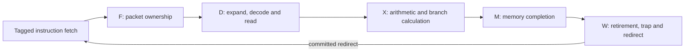
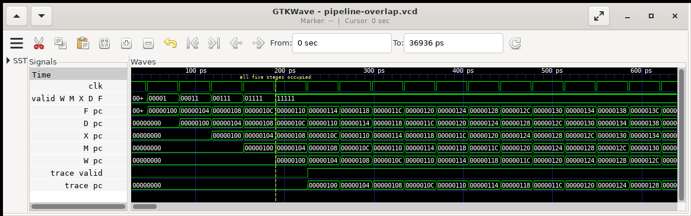
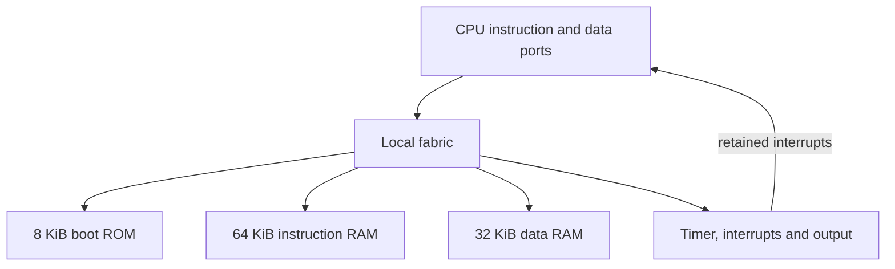

# Five-stage RISC-V CPU

This is a learning implementation of a single-hart, in-order RISC-V CPU. It brings together instruction decoding, pipeline ownership, forwarding, precise exceptions, interrupts and debug, with a small local platform for running freestanding C and assembly. The `cpu5_` prefix identifies the project's RTL modules.

The source includes independently testable datapath components, a five-stage controller, instruction assembly, local memories, a timer, diagnostic output, boot support and verification tools. Hardware programming and full architectural qualification remain open. A passing component simulation does not establish the behavior of every integration or parameter combination.

| Area | Implementation | Guide |
| --- | --- | --- |
| CPU | F, D, X, M and W stages; optional overlapping execution and forwarding. | [RTL and diagrams](rtl/README.md) |
| Instruction set | Configurable RV32I, M and C, plus machine operations, Zicsr and optional Zifencei. | [RTL configuration](rtl/README.md#configuration-and-instruction-set) |
| Local platform | ROM, instruction RAM, data RAM, timer, retained interrupt inputs and diagnostic output. | [Memory](memory/README.md) |
| Firmware | Startup, linker layout, trap handling and compiled execution tests. | [Firmware](firmware/README.md) |
| Debug and boot | Separate JTAG Debug Module integration and validated SPI firmware loading. | [RTL debug](rtl/README.md#cpu-17--debug-integration) and [programming](programming/README.md) |
| Verification | Directed testbenches, reference comparison, architectural tests and scoped formal properties. | [Tests](tests/README.md) and [verification](verification/README.md) |
| FPGA | ECP5 synthesis, place-and-route and primitive smoke checks. | [Synthesis](synth/README.md) and [tools](qualification/README.md) |

## Pipeline

The frontend assembles instruction bytes before admitting a packet to F. D expands compressed instructions and decodes operand use. X computes arithmetic and branch results. M waits for memory completion. W commits architectural state and redirects. Register and CSR updates occur at retirement; memory effects receive separate ordered launch permission.

This GTKWave view of the forwarded overlapping profile shows `valid W M X D F` reaching `11111` at the marker, so all five stages hold an instruction, while the `F pc` to `W pc` rows step forward one address per clock cycle. After the first retirement, `trace valid` stays high every cycle. `addi x1, x1, -2` at `0x108` takes `x1` from the `lui` at `0x104` one stage ahead without a stall. The [waveform guide](tests/README.md#waveform-figures) explains how the figures are exported and read.

The [controller](rtl/cpu5_control.sv) owns the integrated register array and instruction tokens. The standalone [register-file module](rtl/cpu5_regfile.sv) is a separate implementation and mapping experiment, not the instantiated register bank inside that controller. Reads of x0 return zero; ordinary registers have no assumed reset value.

## Configurations

The controller defaults to its diagnostic, single-instruction configuration with optional M, C, interrupts, debug and Zifencei disabled. The [local SoC](rtl/cpu5_soc.sv) selects overlapping execution, enables M and C by default, and enables interrupts, timer access and Zifencei. It leaves CPU debug disabled. The [debug system](rtl/cpu5_debug_system.sv) is a separate integration.

The supported firmware profiles must match the selected hardware. An I-only build does not claim M or C. The selected machine profile uses the ILP32 ABI, little-endian data, naturally aligned accesses and no floating point or virtual memory. Machine counters alone do not advertise Zicntr.

## Local execution platform

The firmware fixture runs calls, stack frames, arrays, arithmetic, interrupts and exception recovery against this platform. Instruction and data request acceptance and response delays are independently configurable in simulation. Deliberate error responses and side-effect counters help expose ordering and duplicate-access defects.

## Getting started

Follow the [host installation guide](../docs/README.md), then run the [fetch-buffer simulation](tests/README.md#first-simulation). The [firmware guide](firmware/README.md) describes matching compiler settings, and the [synthesis guide](synth/README.md) separates a mapped design from a routed candidate. The [programming guide](programming/README.md) distinguishes volatile configuration, persistent configuration and application updates.

Historical development measurements are summarized in the [changelog](../CHANGELOG.md). New source, tool or integration changes require new evidence; this source publication does not contain the old complete campaign archives.
