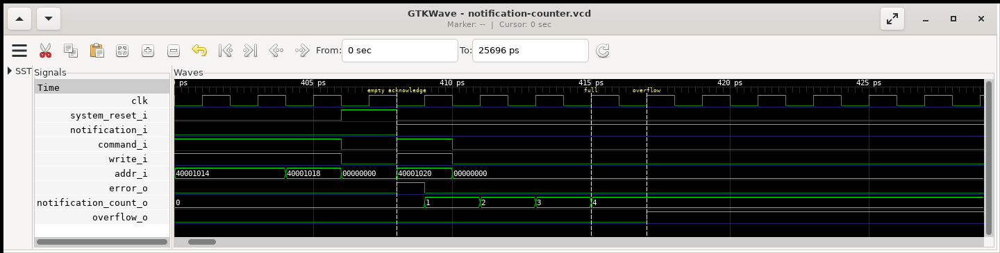
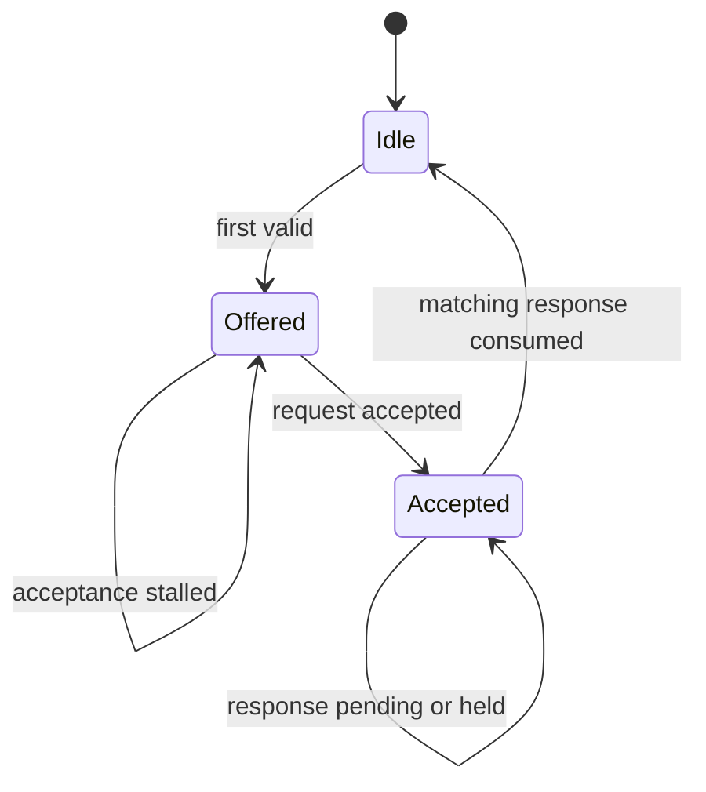
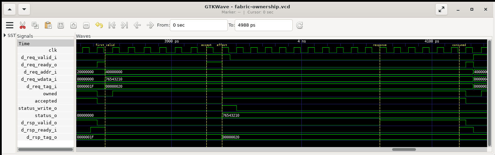

# Local CPU memory and peripherals

The [local fabric](../rtl/cpu5_local_fabric.sv) supplies synchronous memory and a small MMIO platform for CPU execution tests. There is no cache or store buffer. Instruction and data ports each retain one transaction owner through acceptance and response.

## Address map

| Address range | Capacity | Access |
| --- | --- | --- |
| `0x00000000–0x00001fff` | 8 KiB ROM | Instruction fetch and data reads; data writes fault. |
| `0x00010000–0x0001ffff` | 64 KiB instruction RAM | Instruction fetch and data reads/writes. |
| `0x20000000–0x20007fff` | 32 KiB data RAM | Data reads/writes; not an instruction region. |
| `0x40000000` | One word | Diagnostic result/status. |
| `0x40000004` | One word | Diagnostic character output. |
| `0x40000008` | One word | Test event injection. |
| `0x40001000–0x40001fff` | Decoded MMIO window | Only the defined timer/interrupt register addresses are accepted. |

The timer/interrupt register decoder in [cpu5_irq_platform.sv](../rtl/cpu5_irq_platform.sv) is authoritative for individual offsets, permissions and side effects. It exposes split `mtime` and `mtimecmp`, machine software interrupt state, external pending/enables, counted event acknowledgment and overflow status. Undefined addresses and unsupported access shapes return errors; reserving a window does not make every offset legal.

Each clock edge with synchronous `notification_i` high supplies one notification. `NOTIFICATION_CAPACITY` bounds the counter, `notification_count_o` reports it, and `overflow_o` stays set after an overflow until platform reset. Writing bit zero at `0x40001020` acknowledges one notification. A full counter accepts a simultaneous arrival and acknowledgment without overflow. Acknowledging an empty counter faults; a coincident arrival is still counted.

This platform test instance uses `NOTIFICATION_CAPACITY` 4, and `notification_i` stays high after the platform reset. The acknowledge written to `0x40001020` finds the counter empty and returns `error_o` (`empty acknowledge`), yet the coincident notification is counted. `notification_count_o` saturates at 4 (`full`), and `overflow_o` sets on the next edge (`overflow`) and stays set.

## Ownership and ordering

A request becomes owned when valid is first presented. Its address, size, data, byte enables and tag remain stable until acceptance. The response belongs to that same owner and remains stable under response backpressure. Request acceptance delay and response delay are independent simulation inputs. A redirect does not cancel an already offered transaction.

The CPU checks access permissions and natural alignment before launch. Data accesses support bytes, halfwords and words in little-endian lanes. A load into x0 still performs its access and can fault. MMIO effects occur once at acceptance, including reads with side effects. Retirement comparisons must be accompanied by independent bus-effect checks.

Synchronous RAM reads capture at acceptance. An accepted instruction-RAM data write takes priority over a conflicting instruction read; the held fetch waits for admission. Completed writes still require FENCE.I before modified instructions can execute. A separate writer must establish its own completion before asking the CPU to synchronize instructions.

An MMIO write of `0x76543210` to `0x40000000` is first presented (`first valid`) and owned from the next cycle. Its address, data and tag stay stable until the request is accepted (`accept`) after the bench's configured acceptance delay. The status effect happens once, on the following edge (`effect`). The response becomes valid (`response`), is held while `d_rsp_ready_i` is low and is consumed (`consumed`), releasing the owner.

A guaranteed no-effect error can become a precise access fault. An uncertain timeout is a containment condition: an exposed operation cannot be automatically replayed merely because its response was lost. The controller retains the transaction context until isolated recovery.

## Reset and initialization

Memory initialization files supply ROM and instruction RAM for simulation or FPGA configuration. Ordinary RAM is not cleared by CPU reset. The [startup assembly](../firmware/start.S) copies initialized data and clears BSS before C execution; the test environment must not hide missing startup work by preloading zeroed data RAM.

An isolated whole-platform reset may cancel local fabric owners. A hart reset alone must preserve outstanding bus obligations until they drain or the surrounding platform establishes isolation. The [SoC wrapper](../rtl/cpu5_soc.sv) and test fixture determine the applicable reset scope.

## Firmware placement

The [linker script](../firmware/link.ld) puts reset code in ROM, executable code and constants in instruction RAM, and writable state in data RAM. It reserves a 4 KiB downward-growing stack at the top of data RAM, with four guard words below it. Link-time assertions reject ROM/IRAM overflow, stack overlap and trap misalignment. See [firmware](../firmware/README.md) for compiler and trap-frame conventions.

The [local-fabric test](../tests/run_local_fabric.py) checks request ownership, lane shape and effects independently. The [local-platform test](../tests/run_local_platform.py) executes compiled firmware with variable service timing. Neither substitutes for physical memory or board timing measurements.
