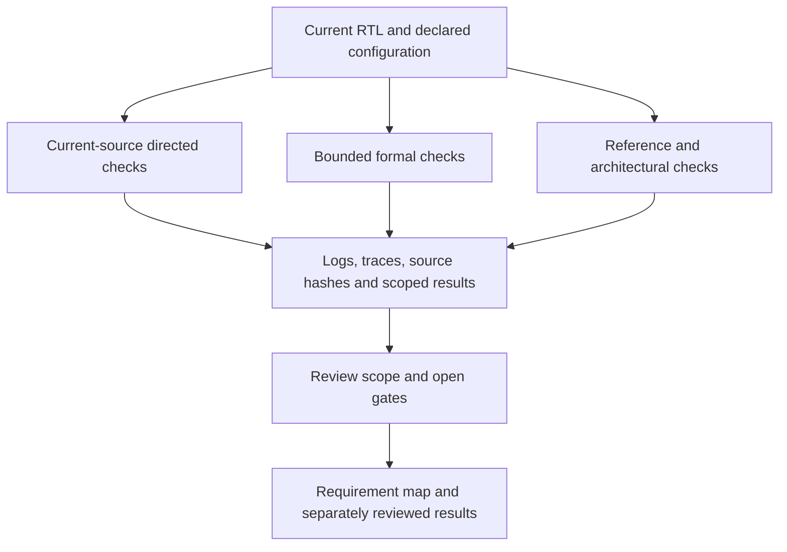

# Verification orchestration

## Purpose

This directory coordinates checks across the CPU, platform and reference model, with a requirement-to-runner map. A fresh execution, replay of an existing capture and audit of a supplied campaign establish different kinds of evidence. The public source does not constitute a fully qualified CPU release.

## Instructions

Start with a focused [test runner](../tests/README.md), then expand to directed families or the [release acceptance planner](../release/README.md). Run commands from the repository root using the Ubuntu/Linux tool environment. Python orchestration alone does not install Verilator, Yosys, solvers, RISC-V GCC, Sail or ACT4. On Windows, enter [Ubuntu WSL2](../../docs/README.md#windows-powershell-and-wsl); on macOS, use an Ubuntu x86-64 VM or [remote Linux host](../../docs/README.md#linux-only-toolchains) for the commands below. These routes do not transfer the recorded results to a new installation.

[run_directed.py](run_directed.py) runs the existing directed checks against current source. It creates isolated source workspaces, retains each attempt and invokes the original checker with its original negative controls. Supply explicit tools and new build/evidence destinations:

```sh
python3 microcontroller/verification/run_directed.py \
  --verilator /tmp/cpu5-control-tools-20260301/oss-cad-suite/bin/verilator \
  --yosys /tmp/cpu5-control-tools-20260301/oss-cad-suite/bin/yosys \
  --build /tmp/cpu5-directed-build-new \
  --evidence-dir /tmp/cpu5-directed-evidence-new
```

Use `--help` to select particular families. This wrapper executes the selected directed suites; it does not run the separate full reference, architectural or formal campaigns. Read each attempt's command, source hashes, runner log and child summary before interpreting the aggregate status.

[run_verification.py](run_verification.py) delegates the combined campaign to the isolated acceptance runner. It requires fresh output and all external dependencies needed by the selected jobs. `all` means the defined software jobs, not every possible instruction/event combination or a physical board acceptance. Inspect the [acceptance guide](../release/README.md) before execution.

With all required tools installed, the combined software campaign uses a fresh destination:

```sh
python3 microcontroller/verification/run_verification.py \
  --build /tmp/cpu5-verification-new
```

The [requirements map](requirements.json) links declared behaviors to existing executable check entry points. Its `not_evaluated_in_this_ledger` fields are not test verdicts: the file does not automatically consume execution reports. Earlier campaign counts remain explicitly undistributed historical context. Read fresh source-bound reports for actual results; reports from different source hashes, configurations or tool installations cannot be merged into a conformance claim.

## Implementation

| Entry point | Role and required inputs |
| --- | --- |
| [run_units.py](run_units.py) | Runs the existing standalone Makefile families with fixed tool paths and campaign outputs. |
| [run_directed.py](run_directed.py) | Executes selected directed runners against copied current RTL and test sources. |
| [formal/run_formal.py](formal/README.md) | Combines bounded controller and fetch checks with their witnesses and failure detectors. |
| [formal/run_admission_formal.py](formal/run_admission_formal.py) | Runs the separate early-admission/finite-service progress harness. |
| [execution/run_elf.py](execution/run_elf.py) | Loads a bounded ELF into the RTL execution platform and records the requested observations. |
| [execution/run_random.py](execution/run_random.py) | Builds generated programs and compares DUT retirement against Sail using the fixed compiler/reference installation. |
| [execution/comparison.py](execution/comparison.py) | Implements independent trace decoding/comparison used by reference runs and replay. |
| [act4/run_campaign.py](act4/README.md) | Coordinates pinned ACT4 generation, reference signatures, bounded DUT execution and inventory. |
| [requirements.json](requirements.json) | Maps requirements to executable runners and separates unevaluated entries from unshipped historical context. |



A comparison pass covers the modeled architectural events and memory contract. A bounded proof covers its stated assumptions and depth. A synthesis result covers the mapped configuration and tools. Hardware behavior, unsupported configurations and omitted test cases require their own evidence.
